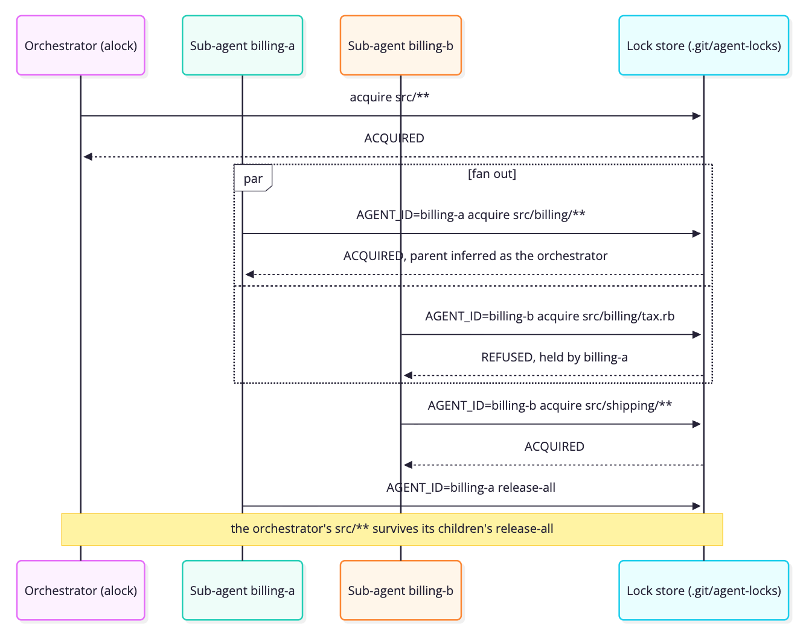

# Distributed Resource Locking for Agents

## Gem **agent-lock**: `alock` CLI and Ruby Interface

> ------
>
> **`agent-lock` is a versatile advisory locking utility which works like a reservation system: it marks certain files, directories, or "glob" patterns as being "owned" temporarily by a particular client or an agent, so that another client that checks the advisory lock on a given file realizes that the files are being modified by another agent and perhaps switch to work on something else.**
>
> **The system is advisory, meaning that agents (or clients) are supposed to both *acquire the locks and query for the locks using the same mechanism.* Most of the time, setting a lock on the folder or a file won't actually prevent you from writing to one.**
>
> ------
>
> [](https://github.com/kigster/agent-lock/actions/workflows/main.yml)  [](https://badge.fury.io/rb/agent-lock) [](https://kigster.github.io/agent-lock/)
>
> 

This is a Ruby Gem that provides both a CLI utility `alock` that supports advisory locks on files and folders with pluggable backends (**redis** and **file system** provided out of the box, with **redis** being the default if it's available locally or if `$REDIS_URL` is set and points to a working Redis), and a Ruby API to the same commands.

> [!NOTE]
>
> Only the Redis backend is distributed. If two or more nodes (virtual servers, laptops, etc.) can reach the same Redis, set `REDIS_URL` on each machine to the same value. A lock taken with `alock acquire`, or with `acquire` from Ruby, is then seen, and refused, on every machine that checks out the same repository and branch.

This locking tool is meant for coding agents that share a project, whether they run on one machine or on several: with every machine pointed at one Redis, it is a distributed lock.

> [!NOTE]
> [OpenLanes](https://github.com/kigster/openlanes) uses `agent-lock` to keep the agents it runs from overwriting each other, but the gem has no dependency on it. Any harness, or a person with three terminals open, can use `alock` on its own.

## What it is

`agent-lock` is a gem with one executable, `alock` (also installed as `agent-lock`). An agent runs `alock acquire <scope>` before it writes, and learns in one reply whether anybody else is working there: who, since when, and doing what. It works for separate sessions in one checkout, for the sub-agents of a single session, the harder case, and for agents on different machines working on one branch of one repository.

Git does not help here. Two agents on one branch and one working tree never produce a conflict: the second writer simply wins, and the first one's work is gone without an error anywhere. A lock stops that, but only if every writer can be named reliably, even though an agent harness runs each command in a brand new shell. Making that name stable, and keeping claims correct when several agents ask at the same moment, is most of what this gem does.

## Who it is for

- **People running several coding agents at once** (Claude Code, Codex, Cursor, a terminal of your own) in the same checkout.

- **Orchestrators that fan out sub-agents** into one worktree, each taking a different part of it.

- **Harnesses** that launch agents over a repository and need them to stay out of each other's way.

- **Teams of agents spread over several machines**, each with its own clone of the repository, at any path. Set `REDIS_URL` to the same shared Redis on every machine, and a claim on one is refused on the others. See [One repository, many machines](#one-repository-many-machines).

Not for work that can have a checkout of its own. A git worktree per agent removes the sharing altogether, which is better than coordinating it. The locks are advisory: they protect a file only from agents that check. `--enforce` exists for the few files that must not move at all.

## How to use it

### Install

```bash
gem install agent-lock
hash -r
alock version  # alock must be on PATH
```

Or add `gem "agent-lock"` to a Gemfile.

### Claim before you write

```bash
alock acquire "lib/billing/**" "rewriting the invoices"   # claim a corner of the tree
alock check   "lib/billing/tax.rb"                        # exits 1 if somebody else holds it
alock note    "lib/billing/**" "totals done, specs red"   # where you are, for whoever comes next
alock list                                                # everything held in this repository
alock release-all                                         # when you are done
```

A refusal tells you who and what, not just that you lost:

```bash
$ alock acquire lib/billing/tax.rb
REFUSED, do not write here
HELD  lib/billing/**  by luke-backend  since 2026-09-09T21:04:11Z
      intent: rewriting the invoices
```

Exit 1 means do not write there. Exit 2 means the command could not run at all.

### Fan out to sub-agents in one worktree

The orchestrator claims the area it hands out, running `alock` bare. Each sub-agent then claims its own part of it, naming itself on every call:

```bash
alock acquire "src/**" "fanning out the billing work"            # orchestrator

AGENT_ID=billing-a alock acquire "src/billing/**" "tax rounding"  # sub-agent A
AGENT_ID=billing-b alock acquire "src/billing/tax.rb" "..."       # sub-agent B: REFUSED, held by billing-a
AGENT_ID=billing-a alock release-all                              # A's own locks, never the orchestrator's
```



Three things matter, and each one fails silently if skipped:

1. **The name goes on every call.** Sub-agents run inside the parent's process and would sign every lock as the parent. Each call is also a fresh shell, so an `export AGENT_ID` from an earlier call is gone. `AGENT_ID=<name> alock whoami` shows the name a lock would be signed with.

1. **Run `alock` in the checkout being written**, with `cd` or `--dir`. A lock in another repository protects nothing.

1. **Sub-agents claim even inside the orchestrator's lock.** The orchestrator's lock keeps other sessions out; only a sub-agent's own claim keeps its siblings out.

### Teach your agents

The gem ships a skill that teaches an agent all of the above, so the rules reach the agents rather than living only in this README. Install it into the skills directory your agent reads:

```bash
alock skills install                   # into ~/.agents/skills, read by most agents
alock skills install --for claude      # into ~/.claude/skills
alock skills install --into some/path  # anywhere else; wins over --for
alock skills path                      # where the bundled copy is
```

`install` refuses to replace a copy that differs (`--overwrite` replaces it) and never touches a symlink, since a symlink belongs to some other installer.

If a manifest-driven installer manages your skills, point it at this repository instead, so the skill is recorded with where it came from:

```yaml
- name: agent-lock
  type: skills
  repo: git@github.com:kigster/agent-lock.git
  path: skills
```

Then put the rule where every agent reads it, such as `CLAUDE.md` or `AGENTS.md`:

```markdown
Several agents may work in this checkout at once. Before creating or editing
files, load the agent-lock skill and claim the narrowest scope that covers your
writes:

    alock acquire <scope> "<what you are doing>"

If it refuses, work somewhere else. A sub-agent prefixes every call with its
own name: AGENT_ID=<sub-agent-name> alock acquire ... 

Release with `alock release-all` when you are done.
```

Advisory locks work because everybody checks. That is why the rule belongs in the instructions your agents load, and not only here.

### Ruby API

The utility was built CLI-first, so that any language and any agent framework can use it. A Ruby project pays less by calling its Ruby API instead: `Agent::Lock::Facade` runs every command in-process, which saves a `fork()`/`exec()` per call.

A Ruby process can also hold more than one locker, for example one per checkout, or a Redis locker and a file-store locker kept deliberately apart. Within one checkout, though, the backend marker binds every locker to the backend that checkout chose first: a file-store facade raises `Agent::Lock::Store::Mismatch` in a checkout claimed for Redis, and two facades on two Redis URLs never see each other's locks. Use separate lockers for separate checkouts or namespaces, never to split one checkout.

#### Mapping `alock` Commands to Ruby API

The same commands that are available when you run `alock -h` become methods on an instance of the class `Agent::Lock::Facade`, and run within your process, so no Ruby process is started per call. Each returns the `Manager::Result` (`status`, `records`, `record`). Where the command would print a refusal, the method raises `Agent::Lock::Refused`: the message says who holds the scope, and `result` is the `Manager::Result` behind it. Releasing, breaking or resuming a free scope is not a refusal: it returns `:not_found`, although the command exits 1.

#### Types of Locks

There are three types of Ruby API locks you can use, and each is an instance of the class `Agent::Lock::Facade`:

1. A default version of a local file-system based lock that works great for a single repository work on multiple agents on a single machine. It can be lazy loaded by calling `Agent::Lock.local`
2. A default version of a distributed lock can be obtained by calling `Agent::Lock.distributed`. It lazily builds a Redis-backed locker, one per URL, from `redis_url:` when given (`Agent::Lock.distributed(redis_url: url)`), else `$AGENT_LOCK_REDIS_URL`, else `$REDIS_URL` (default `redis://localhost:6379`), and raises `Agent::Lock::RedisUnavailableError` when that Redis does not answer.
3. And of course you can create any number of `Agent::Lock::Facade` instances by calling its constructor: `@locker = Agent::Lock::Facade.new(*args, **opts)` (see examples below).

#### Examples

The first example is the shared local file-system based lock.

```ruby
require "agent/lock"

# First we'll use a File-System local lock which is cheap and fast
# NOTE: the current directory is expected to be a git project.
locker = Agent::Lock.local # file store, built once per process. 

# Now we acquire an advisory lock on all files under lib/billing, presumably
# because we want to work on a billing feature.

locker.acquire "lib/billing/**", "rewriting the invoices", agent_id: "backend-agent"
locker.note    "lib/billing/**", "totals done, specs red", agent_id: "backend-agent"
locker.check   "lib/billing/tax.rb", agent_id: "backend-agent" # :mine

# And release all locks held by this agent
locker.release_all(agent_id: "backend-agent")
```

#### Acquire with a block

Given a block, `acquire` yields the result, returns the block's value, and releases the lock afterwards, even when the block raises, `break`s or `throw`s. It releases only a lock this call took: inside a scope you already hold, the result is `:already_mine`, and the outer lock survives the inner block. A refusal raises before the block runs. If somebody broke your lock and took the scope while the block ran, the block's own exception still propagates; a block that finished gets the refused release as `Agent::Lock::Refused`.

```ruby
locker.acquire("lib/billing/**", "rewriting the invoices", agent_id: "backend-agent") do |lock|
  lock.status # => :acquired
  rewrite_invoices
end # released here
```

#### Async

`Facade.new(async: true)` adds `#async`, which runs any lock method on concurrent-ruby's I/O pool and returns a `Concurrent::Promises::Future`. Arguments, keywords and blocks pass through exactly as on a direct call. `value!` returns the result or raises what the call raised; `value` returns nil on failure, with the error in `reason`. Direct calls on the same facade stay synchronous.

One facade's async calls run one at a time, in the order they were made, so `async.acquire`, `async.note` and `async.release` issued back to back take effect in that order, and fifty `async.note` calls leave fifty notes. Calls on different facades run in parallel. A block given to `async.acquire` runs on that queue: inside it call the facade directly, or call `#async`, which runs inline there.

concurrent-ruby is not a direct dependency of this gem, though `dry-cli-ui` currently installs it. Add `gem "concurrent-ruby"` to your Gemfile so `async: true` does not rest on that; if the gem is missing, `async: true` raises `LoadError` naming it.

```ruby
locker = Agent::Lock::Facade.new(strategies: %w[redis], async: true)

future = locker.async.acquire("lib/billing/**", "rewriting the invoices", agent_id: "backend-agent")
future.value!.status # => :acquired, or raises Agent::Lock::Refused

locker.async.release("lib/billing/**", agent_id: "backend-agent").wait
```

Wait on every future whose outcome matters, a `release` above all: a future still running when the process exits can be dropped, and the lock then lives until it is reaped.


`strategies` are tried in order. `filesystem` is another name for `file`. A list that is only `redis` raises `Agent::Lock::RedisUnavailableError` (a `RuntimeError`) at construction when that URL does not answer.

A facade is frozen and builds a fresh `Manager` per call, so one instance can be shared by any number of threads. `Agent::Lock.local` and `Agent::Lock.distributed` are memoized separately, built once even when several threads ask at the same time, and a `distributed` that failed to connect is retried on the next call. `Facade.new` and `Agent::Lock.facade` each build a fresh facade and leave those two in place. Two facades pointed at two Redis URLs keep separate locks. The checkout's backend marker binds a facade as it binds `alock`: a facade claims a new checkout for its backend, and raises `Agent::Lock::Store::Mismatch` in one already claimed for the other, so a facade and the CLI never split one checkout across the file store and Redis. The marker names the backend, not the Redis URL: a facade given another `redis_url` than the CLI's `REDIS_URL` is still a separate locker.

A facade ties each lock's liveness to its own Ruby process (`holder: :process`, the default), so the locks of a host that crashes are reaped like those of a dead `alock` session. `alock` ties a lock to the first ancestor that is not a shell, because its own process exits after every command; pass `holder: :session` for that behaviour, for example from a short script whose lock should outlive it. Either way the lock is signed with the session's holder id, so a script and the `alock` of the session that runs it are one holder.

A host that restarts while its work goes on names its session instead. `session_name:` (a plan id, a job id: letters, digits and `. _ : @ / + -`) is used as given in place of `CLAUDE_SESSION_ID` and the fingerprint. It signs the facade's locks unless the call passes `agent_id:` or `AGENT_ID` is set, and then it is that holder's inferred parent. A lock taken under a session name is tied to no process, the named agents' locks included:

- It survives any number of restarts, and a restarted host that gives the same name finds it its own.
- It lapses when untouched for the stale window of whoever looks at it: a plain `alock list` clears one that has been quiet for 120 minutes, whatever `stale_minutes:` its holder passed. `note` is the only heartbeat, so a long silent job should write one now and then.
- A lapsed lock with notes becomes interrupted work, for its own holder too: `resume` takes it back. One without notes is simply free again.
- On Redis, `AGENT_LOCK_TTL_SECONDS` still expires it outright, notes and all.
- Release it when the work is done; nothing else will until the window passes.

`holder:` is for a facade that names no session: `Facade.new` raises `ArgumentError` given both, and a `session_name:` passed to one call overrides the facade's `holder:` for that call.

```ruby
locks = Agent::Lock::Facade.new(strategies: %w[redis], session_name: "plan-003.00")
locks.acquire("lib/billing/**", "building")                   # held by plan-003.00, across restarts
locks.acquire("lib/billing/a.rb", agent_id: "luke-backend")  # its parent is plan-003.00
```

Every lock method takes `dir:`, `agent_id:`, `parent_id:`, `stale_minutes:` and `session_name:`, overriding the facade's defaults for that call; any other keyword raises `ArgumentError`, through `#async` too. `check`, `list`, `mine`, `release`, `release_all`, `resume`, `whoami`, `skills_path`, `skills_install` and `version` take the same arguments as the command. `break` is `break_lock` (it returns the result; the command succeeded). `acquire` takes `enforce:` and `allow_wide:`. `skills_install` takes `into:`, `agent:` (the `--for` flag) and `overwrite:`. `whoami` returns the `Identity` the lock would be signed with.

## How it works

### Identity comes from the session

In order of preference:

| Source              | When it applies                                         |
| :------------------ | :------------------------------------------------------ |
| `AGENT_ID`          | A human or a harness named this session on purpose      |
| `CLAUDE_SESSION_ID` | A harness that exports it, since it survives `--resume` |
| Fingerprint         | Neither of the above is set                             |

The fingerprint walks up from the current process until it finds an ancestor that is not a shell. That is the `claude` or `codex` process driving the session, or the terminal a person is typing in. Its pid, start time, uid and hostname are hashed into a name like `claude-1f4c8a02`, which stays the same for as long as the session lives and differs from anybody else's.

> [!NOTE]
> The start time is in the hash on purpose. PIDs get recycled, and a new session that lands on a dead one's number should not inherit its locks.

`alock whoami` prints the name this session would sign a lock with, its parent, and where each came from. Run it before the first claim if in doubt.

### The file store lives inside `.git`

With the file backend, the store is `$(git rev-parse --git-common-dir)/agent-locks`. The Redis backend keeps the same documents in Redis instead; see [Backends](#backends).

| Property                                      | Why it matters                                   |
| :-------------------------------------------- | :----------------------------------------------- |
| Git cannot track anything in `.git`           | No repository needs a `.gitignore` entry         |
| `git clean -xdf` cannot reach it              | A cleanup does not silently drop every lock      |
| Every worktree resolves to the same directory | One store serves the whole repository            |
| It is deleted with the checkout               | Nothing outlives the repo in your home directory |

Outside a git repository the store falls back to `~/.agent-locks`, keyed by a digest of the tree.

### A lock is a document, not a flag

```markdown
---
agent_id: luke-backend
scope: workflow/**
status: active
pid: 69232
created_at: 2026-09-09T21:04:11Z
---
Rewriting the installer

## Progress
- 2026-09-09T21:14:02Z installer rewritten, specs still red
```

An agent that runs into this learns who owns the scope and what they are doing, so it can decide whether to wait or work elsewhere. A human can read the same file in an editor.

### Scopes are globs

| Scope         | Means                                              |
| :------------ | :------------------------------------------------- |
| `**`          | The whole tree                                     |
| `workflow/**` | Everything under `workflow`                        |
| `workflow`    | The same thing. A directory means everything in it |
| `lib/cli.rb`  | One file                                           |

Two scopes conflict when one fixed part contains the other. So `workflow/**` conflicts with `workflow/lib/cli.rb`, and `docs/**` does not conflict with `workflow/**`.

> [!TIP]
> The rule deliberately refuses more often than it strictly must. Whether two globs can ever match the same path is unpredictable, and guessing wrong costs somebody lost work.

A scope is read from where you stand, globs included, and an absolute path inside the tree is made relative. So `$PWD/lib/**` and `lib/**` are the same claim, and `*.rb` typed in `lib/` is `lib/*.rb`. Only `.`, `*` and `**` mean the whole tree from anywhere. Two things are refused with exit 2 rather than guessed at:

| Scope                        | Why it is refused                                                                                          |
| :--------------------------- | :--------------------------------------------------------------------------------------------------------- |
| `""`                         | Usually an unset variable. Claiming the whole tree by accident blocks everybody; write `**` if you mean it |
| `/etc/passwd`, `../other/**` | Outside the tree, so no lock in this store can protect it                                                  |

### Sub-agents are a family, not one holder

Ownership and blocking are separate questions, and conflating them is what lets sibling sub-agents overwrite each other.

| Relationship            | May claim an overlapping scope                            | Appears in `mine`, can be released |
| :---------------------- | :-------------------------------------------------------- | :--------------------------------- |
| Yourself                | Yes, it is already yours                                  | Yes                                |
| Your parent session     | Yes, inside its claim, and the claim is recorded as yours | No                                 |
| A sub-agent you spawned | No, you handed that scope out                             | Yes, so cleanup takes them with it |
| A sibling sub-agent     | No                                                        | No                                 |

A sub-agent claiming inside its parent's lock gets its own lock, and that lock keeps its siblings out. Asking for exactly the parent's scope is refused, since that would leave nothing for a sibling to be kept out of; claim something narrower. A sub-agent's `release-all` gives back its own locks and its children's, never its parent's.

#### Sub-agents that share their parent's process

Claude Code runs sub-agents inside the parent's own `claude` process, and sets nothing in the environment that tells them apart. They therefore share the parent's fingerprint, and without help every one of them would sign locks as the parent and none would ever block another.

So a sub-agent names itself, on every call, since each command runs in a fresh shell and an `export` does not survive to the next one:

```bash
AGENT_ID=luke-backend alock whoami                        # id luke-backend, parent claude-1f4c8a02 (inferred)
AGENT_ID=luke-backend alock acquire lib/billing/** "invoices"
AGENT_ID=luke-backend alock release-all
```

When `AGENT_ID` is set and `AGENT_PARENT_ID` is not, the parent is taken to be the session's own name, `CLAUDE_SESSION_ID` if the harness exports it and the fingerprint otherwise, which is the orchestrator running bare `alock`. Set `AGENT_PARENT_ID` explicitly when the parent named itself too.

A holder that is nobody's child says so with `AGENT_PARENT_ID` set and empty (`AGENT_ID=svc AGENT_PARENT_ID= alock acquire ...`), or `parent_id: false` in Ruby, per call or as a facade default. A top-level service that names itself needs this: left to inference it is the child of whatever terminal or agent started it, and a lock that session holds does not block it. Unset still infers. Three things follow from it being an environment variable:

- `alock whoami` prints `parent: none  (AGENT_PARENT_ID is set and empty)`, so a variable exported empty by accident can be told from having no parent to infer. Such a sub-agent is refused inside its orchestrator's lock, and its orchestrator's `release-all` does not release its locks.
- A service that exports it empty passes that to the agents it starts. Give each of them `AGENT_PARENT_ID=<the service's id>`.
- In Ruby, `parent_id: nil` means "not said": the facade's default applies, then the process's own `AGENT_PARENT_ID`, then inference. A blank String raises `ArgumentError`.

> [!NOTE]
> The same rule applies in a terminal. Setting `AGENT_ID` there makes the terminal's own session your parent, so a bare `alock` typed in that terminal can release what you claimed under the name.

### A crash does not strand the tree

A lock is cleared when its holder is provably gone: the process that signed it has exited on this machine. A holder on another machine cannot be checked, so its lock is trusted until nobody has touched it for `AGENT_LOCK_STALE_MINUTES` (120 by default). Every `note` counts as a touch. What happens next depends on whether anything was written down:

| The lock has | What happens to it                               |
| :----------- | :----------------------------------------------- |
| No notes     | Deleted. There is nothing to come back to        |
| Notes        | Orphaned. The claim is void, the record survives |

```
$ alock acquire workflow/**
INTERRUPTED WORK on workflow/**, left by luke-backend
  alock resume workflow/**   # take it back, notes and all
  alock break workflow/**    # throw it away and start over
```

> [!WARNING]
> An orphan blocks nobody, but `acquire` will not silently overwrite one, because the notes inside it may be the only record of half-finished work. Choose `resume` or `break`.

A live holder's lock is never cleared, no matter how old it is. (A lock taken under a `session_name:` names no process, so it is the exception: see the Ruby API section.) An agent may legitimately work on one scope for hours, and deleting its lock underneath it would hand its files to the next agent while it is still writing them. Past the stale window `list`, `check` and `mine` tag it `STALE` instead, and taking it is a `break` that somebody announces first.

```
$ alock list
Locks held (2):
app/**	orchestrator	2026-09-11T16:04:56Z
  fanning out
docs/**	slow-agent	2026-09-11T13:04:55Z	STALE
  rewriting the guides
Interrupted (1):
db/**	crashed-agent	2026-09-11T15:54:55Z	INTERRUPTED
  splitting the migrations
```

Only live claims are counted as held. `--json` gives every record its `status` and a `stale` flag.

## Commands

`alock --help` lists them; `alock <command> --help` shows each one's arguments, flags and examples.

| Command                    | Does                                                    | Exits 1 when                                      |
| :------------------------- | :------------------------------------------------------ | :------------------------------------------------ |
| `acquire <scope> [intent]` | Claim a path, directory or glob before writing there    | held, interrupted, or exactly your parent's scope |
| `release <scope>`          | Give a lock back, thawing any files it froze            | somebody else holds it                            |
| `check <scope>`            | Say who holds a path                                    | another agent holds it                            |
| `note <scope> <text>`      | Append a timestamped progress note to your lock         | you do not hold it                                |
| `resume <scope>`           | Take back work a crash or reboot interrupted            | there is nothing to resume, or it was re-claimed  |
| `break <scope>`            | Take a lock from its holder, even a live one            | nothing is locked there                           |
| `list` (`ls`)              | Every lock in this repository, live and interrupted     | never                                             |
| `mine`                     | Locks held by this session and its sub-agents           | never                                             |
| `release-all`              | Release all of those                                    | never                                             |
| `whoami`                   | The id your locks would carry, its parent, their source | never                                             |
| `skills install`           | Copy the bundled skill into a skills directory          | a different copy, or a symlink, is there          |
| `skills path`              | Print where the bundled skill lives                     | never                                             |
| `completion bash\|zsh`     | Print a shell completion script                         | any other shell                                   |
| `version`                  | Print the installed version                             | never                                             |

Flags:

| Flag           | Where                                                              | Does                                                       |
| :------------- | :----------------------------------------------------------------- | :--------------------------------------------------------- |
| `--dir PATH`   | every command that reads locks (not `whoami`, `skills`, `version`) | Act on the checkout that contains `PATH`                   |
| `-s`, `--locking-strategy redis\|filesystem` | the same commands | Use that store, instead of `AGENT_LOCK_BACKEND` or whichever answers first |
| `-u`, `--redis-url URL` | the same commands | Use that one Redis, with no fallback. Implies `--locking-strategy redis` |
| `--json`       | `check`, `list`, `mine`, `whoami`                                  | Machine-readable output                                    |
| `--enforce`    | `acquire`                                                          | Also freeze the matched files (macOS)                      |
| `--allow-wide` | `acquire`                                                          | Let `--enforce` freeze more than 500 files                 |
| `--into DIR`   | `skills install`                                                   | Install into `DIR`                                         |
| `--for AGENT`  | `skills install`                                                   | `claude` means `~/.claude/skills`, else `~/.agents/skills` |
| `--overwrite`  | `skills install`                                                   | Replace an installed copy that differs                     |

Any command exits 2 when it cannot run at all: an empty or out-of-tree scope, a backend mismatch, a freeze that is refused, or a store it cannot reach.

## Shell completion

```bash
alock completion bash > "$(brew --prefix)/etc/bash_completion.d/alock"
alock completion zsh  > "${fpath[1]}/_alock"
```

Names every command and flag `alock` currently knows, since the script is generated from the same registry the CLI runs on, rather than hand-maintained separately.

## Configuration

| Variable                   | Default                                 | Does                                                                     |
| :------------------------- | :-------------------------------------- | :----------------------------------------------------------------------- |
| `AGENT_ID`                 | fingerprint                             | Name this session yourself                                               |
| `AGENT_PARENT_ID`          | the fingerprint, when `AGENT_ID` is set | The session that spawned this one. Set and empty: no parent              |
| `AGENT_LOCK_DIR`           | `.git/agent-locks`                      | Keep locks somewhere else                                                |
| `AGENT_LOCK_STALE_MINUTES` | `120`                                   | When a lock is tagged `STALE`, and when one from another machine, or with no process, expires |
| `AGENT_LOCK_MUTEX_TIMEOUT` | `15`                                    | Seconds a claim waits for the store's mutex before giving up with exit 2 |
| `AGENT_LOCK_BACKEND`       | `redis` if one answers, else `file`     | `file` or `redis`                                                        |
| `AGENT_LOCK_TTL_SECONDS`   | `0`                                     | Redis expiry. `0` means no TTL                                           |
| `REDIS_URL`                | unset                                   | A shared Redis, tried before `redis://127.0.0.1:6379/0`                  |
| `AGENT_LOCK_REDIS_URL`     | unset                                   | The one Redis to use, with no fallback: `--redis-url` for every call     |

## Backends

Redis stores the same documents as the file store, and buys two things a filesystem cannot: its mutex holds across machines, and a TTL expires an abandoned lock without anybody having to reason about liveness. A tree defaults to Redis when one answers, and falls back to the file store, which needs nothing installed, when none does.

The search for a Redis runs in a fixed order: `REDIS_URL` first, when it is set, then `redis://127.0.0.1:6379/0`. A `REDIS_URL` nobody answers on is not the end of it, since the usual reason to set one is a shared instance that is occasionally down, and a local Redis is still a better lock store than the filesystem. Only when neither answers does the tree land on the file store. `alock list` names the store in use, so it is never a guess which one you are on.

```bash
AGENT_LOCK_BACKEND=redis alock acquire workflow/**   # force it, rather than autodetect
AGENT_LOCK_BACKEND=file  alock acquire workflow/**   # or force the file store instead
```

The same choice can be made per call, which is how an agent started by a dispatcher lands in the dispatcher's store whatever its own shell exports:

```bash
alock acquire workflow/** --locking-strategy filesystem            # -s for short; file is another name for it
alock acquire workflow/** --locking-strategy redis                 # Redis or fail: REDIS_URL, then the local default
alock acquire workflow/** --redis-url redis://locks.internal:6379  # -u for short: this Redis and no other
alock release workflow/** --redis-url redis://locks.internal:6379  # every later call names it too
```

- A flag wins over `AGENT_LOCK_BACKEND`. Neither wins over the tree's marker: naming the store the tree does not use exits 2.
- `--redis-url` has no fallback. If nothing answers there, or it is empty or not a Redis URL, the command exits 2 and a virgin tree is left unclaimed. A password in it is never printed back.
- `AGENT_LOCK_REDIS_URL` means the same as `--redis-url` on every call, and the flag wins over it. It is the form for a dispatcher: exported to the agents it starts, it reaches their sub-agents and every fresh shell, keeps a URL with a password out of prompts and transcripts, and leaves `REDIS_URL` to the project being worked on. The Ruby facade reads it before `REDIS_URL` too.
- The marker records `redis`, not which Redis. Every agent in the tree has to be given the same URL, by the flag or by `REDIS_URL`; two URLs are two stores that cannot see each other's locks.
- A Redis URL, from the flag or the variable, beside the file store (`--locking-strategy filesystem` or `AGENT_LOCK_BACKEND=file`) exits 2.
- `--locking-strategy redis` with no URL is Redis or fail as well: if neither `REDIS_URL` nor the local default answers, it exits 2 without claiming the tree.

### One repository, many machines

A lock is about a repository and the files in it, not about where a checkout sits on disk. Point every machine at one Redis with `REDIS_URL`, and each checkout of the repository reads the same locks, wherever it is cloned:

| Two checkouts of one repository                  | Do their locks collide?                                    |
| ------------------------------------------------ | ---------------------------------------------------------- |
| Same branch, any machine, any path               | Yes, on overlapping scopes; different files are fine       |
| Different branches, such as two worktrees        | No: separate branches are what a worktree is for           |
| One checkout that switched branch after claiming | Yes: the files on disk did not change hands                |
| A detached HEAD                                  | Only within that checkout, since it has no branch to share |

The repository is named by its `origin` URL, normalized so that `git@github.com:a/b.git` and `https://github.com/a/b` agree. A repository with no `origin` is named by its root commit, and a directory outside git by its path.

#### Why this makes it a distributed lock

Before 3.1.0 a lock was named after the checkout's absolute path. A shared Redis did not help: `/Users/a/repo` on one laptop and `/home/b/repo` on a build box hashed to two unrelated namespaces, so each machine saw only its own locks, and two agents on two hosts could both claim `lib/billing/**` on `main` and both be told they won. Since 3.1.0, with every machine on one `REDIS_URL`, the gem has everything a distributed lock needs:

| A distributed lock needs                 | How `agent-lock` provides it                                                                                                                                                                                                                                                  |
| :--------------------------------------- | :---------------------------------------------------------------------------------------------------------------------------------------------------------------------------------------------------------------------------------------------------------------------------- |
| One name for the resource on every host  | A lock's id comes from the repository, branch and scope, which every clone computes the same way. Nothing local, such as a path or a username, goes into it                                                                                                                   |
| One store that every host reads          | Every checkout of a repository reads and writes `agent-lock:<repository digest>` in the shared Redis                                                                                                                                                                          |
| Mutual exclusion across hosts            | The conflict check and the write run under `agent-lock-mutex:<repository digest>`, taken with `SET NX PX` and a random token and released by compare-and-delete. The lock itself is written with `SET NX`, so two hosts after the same id cannot both create it               |
| Recovery from a holder that disappears   | A crashed holder's mutex lease runs out within 10 seconds. A pid on another host cannot be checked, so that host's lock expires once nobody has touched it for `AGENT_LOCK_STALE_MINUTES`, and every `note` counts as a touch. `AGENT_LOCK_TTL_SECONDS` adds a hard Redis TTL |
| A boundary on what counts as a collision | Locks collide only on the same branch. Worktrees on their own branches stay independent, which is what a worktree is for                                                                                                                                                      |

Where the guarantees stop:

- **It is advisory.** A lock protects a file only from agents that check. `--enforce` freezes files on the local machine only.
- **Every host has to reach the same Redis.** If the shared `REDIS_URL` does not answer, a command falls back to `redis://127.0.0.1:6379/0`, and that host is then working in a different store from the others without being told. When agents on several machines depend on the lock, keep the shared Redis up and check that `alock list` names it on each one.
- **It is one Redis, not a quorum.** Lock state lives on a single instance. A failover to a replica that has not received the latest writes can lose recent claims, so this is not Redlock, and it is not meant to guard anything stronger than agents editing files.
- **The mutex lease is not renewed.** A critical section that outlives its 10-second lease fails with an error rather than continuing unprotected, so a slow claim costs a retry, not a double grant.

> [!IMPORTANT]
> Upgrading from 3.0.0 or earlier changes the Redis namespace. Locks taken by an older version are not visible to 3.1.0, so release them before upgrading. 3.1.0 never reads the old namespace, so it never reaps those keys either: they stay in Redis until their `AGENT_LOCK_TTL_SECONDS` runs out, and with the default of `0` they stay for good. They block nobody, but they have to be deleted by hand. The file store is not affected. Its records stay in `.git/agent-locks`, still block overlapping claims in the checkout that took them, and are reaped as usual.

Either way, every claim checks for conflicts and writes its lock while holding one mutex for the whole store. Refusing an atomic write of an identical scope is not enough on its own: `lib/**` and `lib/cli.rb` are different keys, and two agents claiming them at the same moment would both find the store empty and both win. The file store takes an exclusive `flock` on `.mutex` beside the locks. Redis takes `agent-lock-mutex:<repository digest>` with `SET NX PX` and a random token, and gives it back with a compare-and-delete script, so a process whose lease ran out cannot release somebody else's.

> [!CAUTION]
> Picking a default from whether Redis happens to answer is still never a runtime auto-*switch*. If one agent found a running Redis and switched to it while the agent beside it did not, the two would take locks in different stores, see nothing of each other, and both report success — worse than no lock at all. The first store created in a tree records its backend in a marker file, and every later process in that tree is bound to it regardless of what Redis does next; a mismatch stops the run rather than silently picking the other one.
>
> That default is decided at the one moment two processes could otherwise race: both find a virgin tree, both probe Redis, and a flaky answer could hand them different defaults before either writes the marker. The marker is claimed atomically — written to a temp file and hard-linked into place, so the first link wins and the marker never exists empty — and every process builds from whatever ends up on disk, never from its own guess, so a race can land on either backend but never on a split.

The `redis` gem ships as a dependency of this one now, since deciding the default means probing for it. If you never want that probe, or never install a local Redis, set `AGENT_LOCK_BACKEND=file` yourself.

## Freezing files, on macOS

`acquire --enforce` also runs `chflags uchg` on every matched file, which makes them unwritable by anything, whether it checks for locks or not.

```bash
alock acquire "config/credentials/**" "keys must not move during the migration" --enforce
```

> [!WARNING]
> This is opt-in for three reasons. It's macOS-only, since the Linux equivalent (`chattr +i`) requires root. It denies the holder too, so it suits a freeze rather than a file you are editing. And a session that dies leaves the files frozen, at which point `git checkout` and `rm -rf` start failing with "Operation not permitted".
>
> Every frozen path is written into the lock, so `release` and `break` thaw them without needing the process that froze them to still exist.

## Development

```bash
bin/setup
bundle exec rspec                               # against the file backend
AGENT_LOCK_TEST_BACKEND=redis bundle exec rspec # the same suite, against Redis
bundle exec rubocop                             # or: just lint
bundle exec rake doc                            # YARD site in doc/ (git-ignored), opened in a browser
```

The suite runs against one backend at a time, picked by `AGENT_LOCK_TEST_BACKEND` rather than the machine's own default, so it is deterministic whether or not Redis is running. A Redis run uses database 15, so it never touches a developer's own data. CI runs both backends, plus rubocop as a third job.

The `justfile` covers the rest: `just lint`, `just test`, `just test-coverage`, `just ci` (lint, then coverage), `just format` (autocorrect, then regenerate `.rubocop_todo.yml`), `just doc`, and `just publish` / `just release` for cutting a version.

The library decides and the CLI prints. Every verb is a method on `Agent::Lock::Manager` that returns a `Result` and prints nothing, so the lifecycle is tested without capturing output. `Launcher` takes `argv`, `stdin`, `stdout`, `stderr` and `kernel` as arguments, and nothing below it calls `puts` or a bare `exit`, which lets Aruba run the CLI end to end inside the test process. Every public class, method and constant carries YARD documentation; `yard stats --list-undoc` stays at 100%.

## License

MIT

## Authors

- Konstantin Gredeskoul @kigster
- Claude Code, @claude
